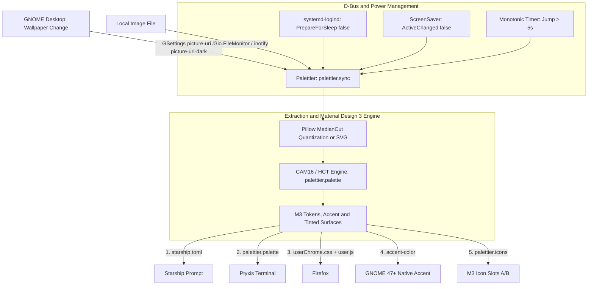

# Palettier

> **Language:** **English** | [Português (PT-BR)](README.pt-BR.md)

[](LICENSE)
[](pyproject.toml)

Dynamic **Material Design 3** theme and icon pack synchronizer for Linux desktops (GNOME), extracting a cohesive color palette directly from your active wallpaper.

---

## 1. Overview

**Palettier** detects your active wallpaper (via GNOME GSettings, slideshow XML descriptors, or local image files), extracts the dominant accent color using adaptive quantization, and computes **Material Design 3 (CAM16 / HCT)** tonal tokens to automatically synchronize:

- **Dynamic Material Design 3 Icon Pack** (`Palettier-M3-A` / `Palettier-M3-B`):
  - System folders (`places/`) and file types (`mimetypes/`) rendered as SVG icons driven by M3 tonal tokens.
  - Shape-preserving M3 tonal filter applied to the original icons of **all installed applications** (system, user, Flatpak, Snap, and **AppImage** `.desktop` entries), keeping 100% of original silhouettes, transparency, and geometry intact.
- **Terminal Prompt (`Starship`)** (`~/.config/starship.toml`).
- **GNOME Terminal Emulator (`Ptyxis`)** (`palettier.palette` + GSettings profile update).
- **`Firefox` Web Browser** (`userChrome.css` and `user.js` across all active profiles, supporting horizontal and vertical tabs).
- **Native GNOME 47+ Accent Color** (`org.gnome.desktop.interface accent-color`).
- **Optional Settings UI** (`palettier --gui`): native **GTK 4 + Libadwaita** preferences window (with an automatic zero-dependency **Local Web UI** fallback via `--web-ui`).

> [!NOTE]
> **Zero external extension dependencies**: all color extraction and Material Design 3 palette math run natively in Python inside the [`palettier`](palettier/) package.

---

## 2. Architecture & Execution Flow



---

## 3. Quick Installation

### Option A — One-Line Installer (Recommended)

The installer detects your Linux distribution, creates an isolated user virtual environment (`~/.local/share/palettier/venv`), installs `palettier` into `~/.local/bin`, registers the **Palettier Settings** desktop shortcut, and optionally enables the `systemd --user` watcher:

```bash
curl -fsSL https://raw.githubusercontent.com/PedroMachado1/Palettier/main/install.sh | bash
```

Or from a local clone:

```bash
git clone https://github.com/PedroMachado1/Palettier.git
cd Palettier
./install.sh
```

> Installer flags: `--yes` (non-interactive), `--no-service` (skip systemd setup), `--no-gui` (skip `.desktop` shortcut), `--uninstall` (remove everything).

### Option B — Manual `pip` Installation

```bash
git clone https://github.com/PedroMachado1/Palettier.git
cd Palettier
pip install .
```

### Recommended System Packages (for Native GTK 4 UI & `--watch`)

- **Fedora**: `sudo dnf install python3-pillow python3-gobject gtk4 libadwaita`
- **Ubuntu / Debian**: `sudo apt install python3-venv python3-pil python3-gi gir1.2-gtk-4.0 gir1.2-adw-1 gir1.2-gio-2.0`
- **Arch Linux**: `sudo pacman -S python-pillow python-gobject gtk4 libadwaita`
- **openSUSE**: `sudo zypper install python3-Pillow python3-gobject gtk4 libadwaita`

> Without `PyGObject` / `libadwaita`, Palettier still runs normally via CLI and automatically uses the built-in local **Web Settings UI** (`palettier --gui` / `palettier --web-ui`).

---

## 4. Optional Settings UI & Persistent Configuration

### Graphical Settings (`palettier --gui`)

Launch **Palettier Settings** from your GNOME application grid or terminal:

```bash
palettier --gui      # Native GTK 4 / Libadwaita window (auto-falls back to Web UI)
palettier --web-ui   # Force the local HTTP Material 3 Web Settings UI
```

From the interface you can:
- Preview active **Material Design 3** color tokens extracted from your wallpaper.
- Choose **Automatic Accent** or pick a **Custom Accent Color**.
- Adjust **Surface Tint** intensity and **App Icon Tint Strength** (`0.0` to `1.0`).
- Switch icon pack modes (`system`, `places`, `squircle`, `off`).
- Toggle individual theme targets on or off (**Icons**, **GNOME Accent**, **Ptyxis**, **Starship**, **Firefox**).
- Enable or stop the `palettier.service` background watcher and open the HTML icon preview.

### Persistent Configuration (`~/.config/palettier/config.json`)

Preferences saved in `~/.config/palettier/config.json` are shared across CLI runs, `--watch`, the `systemd --user` service, and the Settings UI:

```json
{
  "icon_mode": "system",
  "icon_tint": 0.9,
  "surface_tint": null,
  "accent_override": null,
  "targets": {
    "icons": true,
    "gnome_accent": true,
    "ptyxis": true,
    "starship": true,
    "firefox": true
  }
}
```

Precedence order: **CLI flags** > **Environment variables** (`PALETTIER_ICON_MODE`, `PALETTIER_ICON_TINT`) > **`config.json`** > **Defaults**.

---

## 5. Modules & Integrations

### 5.1. Core & Wallpaper Extraction (`palettier/wallpaper.py` & `palettier/state.py`)

1. **Wallpaper Detection (`get_current_wallpaper_path`)**:
   - Reads `org.gnome.desktop.interface color-scheme` and inspects `picture-uri-dark` or `picture-uri` in `org.gnome.desktop.background`.
   - Converts `file://` URIs, unquotes special characters, resolves GNOME slideshow `.xml` files, and falls back to `~/.config/background`, `~/.fehbg`, and standard wallpaper folders.
2. **Color Extraction (`extract_wallpaper_colors`)**:
   - Resizes raster wallpapers for fast sub-20ms processing and runs 24-color `MedianCut` quantization.
   - Scores candidate colors balancing population, saturation, and lightness:
     $$\text{Score} = \text{Population}^{0.55} \times \text{Saturation}^{1.4} \times \text{LightnessFactor}$$
   - Adaptively computes surface tint intensity (`0.08` to `0.14`) from average saturation and supports vector `.svg` wallpapers.
3. **Runtime State Cache (`$XDG_RUNTIME_DIR/palettier.state`)**:
   - Prevents redundant re-syncs when wallpaper SHA-256, color-scheme, URIs, icon mode, and `config.json` fingerprint are unchanged (unless `--force` is passed).
   - Waits cleanly for active RPM/DNF package transactions before evaluating state.

### 5.2. Material Design 3 Color & Icon Engine (`palettier/palette.py` & `palettier/icons.py`)

1. **CAM16 / HCT Engine (`palettier/palette.py`)**:
   - Pure-Python `SchemeTonalSpot` (Material Design 3) deriving **Dark** and **Light** tokens (`primary`, `secondary`, `tertiary`, `error`, `surfaceContainer*`, `outlineVariant`) with verified WCAG contrast ratios.
   - Generates perceptual lookup tables (`build_icon_tint_luts`) to recolor existing icons into the wallpaper palette while preserving highlights, shadows, pure whites/blacks, and contrast.
2. **Folders, Mimetypes & Universal App Icon Tinting (`palettier/icons.py`)**:
   - Generates M3 SVG icons in `~/.local/share/icons/Palettier-M3-{A,B}/scalable/` for `places/` and `mimetypes/`.
   - Scans all installed `.desktop` files (system, user, Flatpak, Snap, **AppImage**, and `XDG_DATA_DIRS`) and resolves icons across installed themes, `pixmaps/`, and loose files in `~/.local/share/icons/` or `~/.icons/`.
   - Applies the M3 tonal filter across `.svg`, `.svgz`, `.png`, `.webp`, `.jpg`, and `.ico` without altering silhouettes, strokes, alpha masks, or geometry.
   - Builds an `Inherits=` chain in `index.theme` prioritizing existing themes (`MoreWaita`, `Papirus-Dark`/`Papirus`, `Adwaita`, `hicolor`).
3. **Reversible AppImage Bridge (`.desktop` with absolute `Icon=`)**:
   - AppImage launchers often write `Icon=/absolute/path/...` into `~/.local/share/applications/*.desktop`, causing GNOME to bypass icon themes.
   - Palettier copies the original icon into `hicolor`, stores a restore manifest in `~/.local/share/icons/.palettier_desktop_icons.json`, and updates `Icon=` to a themeable `palettier-app-*` identifier.
   - Running `palettier --uninstall` restores every modified `.desktop` file to its exact original `Icon=` path.
4. **Icon Modes (`--icon-mode` / `PALETTIER_ICON_MODE`)**:
   - `system` or `full` *(default)*: M3 folders and mimetypes + **all installed apps** tinted with M3 LUTs (adjustable via `--icon-tint`, default `0.90`).
   - `places`: M3 folders, places, and mimetypes only.
   - `squircle`: standardized Material You squircles for core desktop apps.
   - `off`: disables icon pack generation.
5. **Atomic GNOME Hot-Reload**:
   - Alternates between `Palettier-M3-A` and `Palettier-M3-B` via `gsettings`, forcing GNOME Shell and Nautilus to reload icons immediately. The original icon theme is saved in `.palettier_prev_icon_theme` for restoration during `--uninstall`.

### 5.3. Starship, Ptyxis, Firefox & GNOME Accent (`palettier/targets.py`)

- **Starship (`~/.config/starship.toml`)**: updates `[palettes.palettier]` and sets `palette = 'palettier'`.
- **Ptyxis (`~/.local/share/org.gnome.Ptyxis/palettes/`)**: generates `palettier.palette` (including Flatpak paths when present) and updates all profiles via GSettings (`org.gnome.Ptyxis.Profile`).
- **Firefox**: discovers profiles in `~/.config/mozilla/firefox/` and `~/.mozilla/firefox/` via `profiles.ini`, enables `toolkit.legacyUserProfileCustomizations.stylesheets = true;` in `user.js`, and writes `chrome/userChrome.css` with horizontal and vertical tab support.
- **GNOME 47+**: maps the extracted accent color to native `accent-color` in `org.gnome.desktop.interface`.

### 5.4. Real-Time Automation (`palettier/watch.py`)

- **GSettings + `Gio.FileMonitor`**: reacts immediately to wallpaper changes, `color-scheme` toggles (dark/light), or in-place image file overwrites with 2.0s debouncing.
- **3-Layer Suspend & Unlock Recovery**:
  1. System D-Bus (`org.freedesktop.login1.Manager.PrepareForSleep` = `false`);
  2. Session D-Bus (`org.gnome.ScreenSaver` / `org.freedesktop.ScreenSaver` `ActiveChanged` = `false`);
  3. Monotonic clock jump fallback (`time.monotonic()` > 5s between ticks).

---

## 6. Project Layout & System Paths

| Path | Origin / Scope | Purpose |
|---|---|---|
| `pyproject.toml` | Repository | Python package metadata, `palettier` and `palettier-gui` entry points |
| `install.sh` / `uninstall.sh` | Repository | One-step installer and uninstaller scripts |
| `palettier/config.py` | Package | Persistent XDG JSON configuration (`config.json`) |
| `palettier/palette.py` | Package | CAM16 / HCT Material Design 3 engine and tint LUTs |
| `palettier/wallpaper.py` | Package | GSettings helpers, wallpaper discovery, and color extraction |
| `palettier/state.py` | Package | Runtime `.state` cache and RPM/DNF transaction guard |
| `palettier/targets.py` | Package | Starship, Ptyxis, Firefox, and GNOME accent updaters |
| `palettier/icons.py` | Package | M3 SVG generator, app icon tinting, AppImage bridge, and slots |
| `palettier/sync.py` | Package | Idempotent theme synchronization orchestrator |
| `palettier/watch.py` | Package | Real-time GSettings, D-Bus, and file watcher |
| `palettier/gui.py` | Package | Native GTK 4 + Libadwaita Settings UI with Web UI fallback |
| `palettier/web_ui.py` | Package | Zero-dependency local HTTP Material 3 Web Settings UI |
| `palettier/service.py` | Package | Systemd user unit installer and complete uninstaller |
| `palettier/cli.py` | Package | Command-line interface (`palettier`) |
| `palettier/assets/palettier.svg` | Package | Application vector icon |
| `palettier.service` | Repository | Reference systemd user unit template |
| `tests/` | Repository | Automated test suite for HCT, icons, config, targets, UI, and CLI |
| `~/.config/palettier/config.json` | User config | Persistent settings (mode, tint, override, per-target toggles) |
| `~/.local/state/palettier/firefox-userChrome.css` | Generated | Reference copy of generated Firefox `userChrome.css` |
| `~/.local/share/icons/Palettier-M3-{A,B}/` | Generated | Alternating Material Design 3 icon theme slots |
| `~/.local/share/icons/.palettier_prev_icon_theme` | Generated | Backup of the user's previous icon theme name |
| `~/.local/share/icons/.palettier_desktop_icons.json` | Generated | Restore manifest for bridged `.desktop` files (e.g., AppImages) |
| `~/.config/systemd/user/palettier.service` | Generated | User systemd unit for `--watch` |
| `~/.config/starship.toml` | System | Dynamic Starship prompt palette |
| `~/.local/share/org.gnome.Ptyxis/palettes/palettier.palette` | System / Flatpak | Dynamic Ptyxis terminal palette |
| `~/.config/mozilla/firefox/<profile>/chrome/userChrome.css` | System | Dynamic Firefox stylesheet |
| `~/.config/mozilla/firefox/<profile>/user.js` | System | Enables custom `userChrome.css` loading |

---

## 7. CLI Reference & Environment Variables

### Environment Variables

| Variable | Values | Default | Description |
|---|---|---|---|
| `PALETTIER_ICON_MODE` | `system`, `full`, `places`, `squircle`, `off` | `system` | Default Material Design 3 icon generator mode |
| `PALETTIER_ICON_TINT` | `0.0` to `1.0` | `0.90` | Default M3 tonal filter strength for app icons |

### Common Commands

```bash
# Open graphical Settings UI (GTK 4 / Libadwaita or local Web UI fallback)
palettier --gui

# Open local Web Settings UI directly (add --no-browser for headless use)
palettier --web-ui

# Single sync from active wallpaper
palettier

# Force reapply with specific icon mode and tint strength
palettier --icon-mode system --icon-tint 0.90 --force

# Manually override accent color (#HEX) and surface tint intensity
palettier --accent "#7aa2f7" --tint 0.12 --force

# Sync without generating/modifying icon themes
palettier --no-icons

# Generate an HTML preview of the M3 palette and icons
palettier --preview-icons

# Print diagnostics for detected wallpaper, config, accent color, and M3 tokens
palettier --info

# Sync from a specific image file
palettier --image /path/to/wallpaper.jpg

# Run real-time background watcher
palettier --watch
```

### Service Management & Uninstallation

```bash
# Install systemd user service
palettier --install-service

# Check status, stream logs, or restart service
systemctl --user status palettier.service
journalctl --user -u palettier.service -f
systemctl --user restart palettier.service

# Remove only the systemd service
palettier --uninstall-service

# Restore desktop defaults (service, M3 slots, palettes, Firefox CSS, .desktop/icons)
palettier --uninstall

# Complete removal of binaries, desktop shortcut, virtual environment, and themes
./uninstall.sh
```

---

## 8. Automated Tests & Contributing

To validate HCT color math, WCAG contrast, PNG/SVG alpha and geometry preservation, AppImage bridging, dual-slot rotation, persistent config, Web UI API, target configs, and CLI behavior:

```bash
python3 -m unittest discover -s tests -v
bash -n install.sh uninstall.sh
```

Contributions are welcome! See [CONTRIBUTING.md](CONTRIBUTING.md) and [LICENSE](LICENSE) (MIT).
