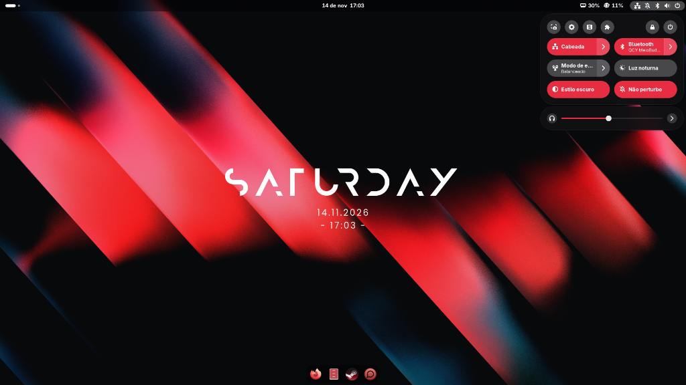
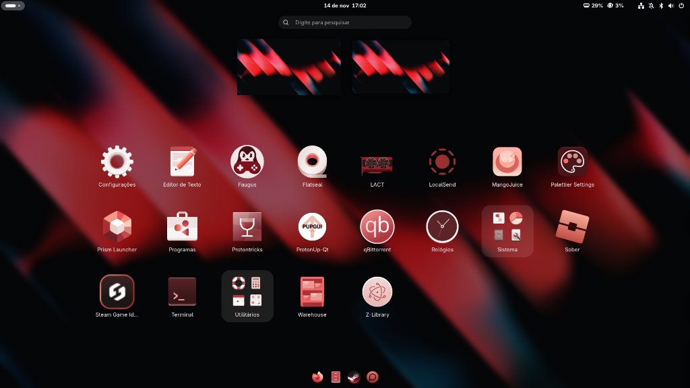
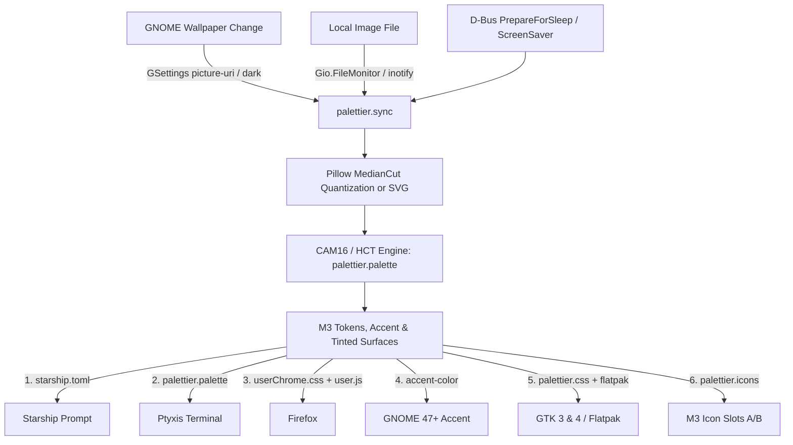
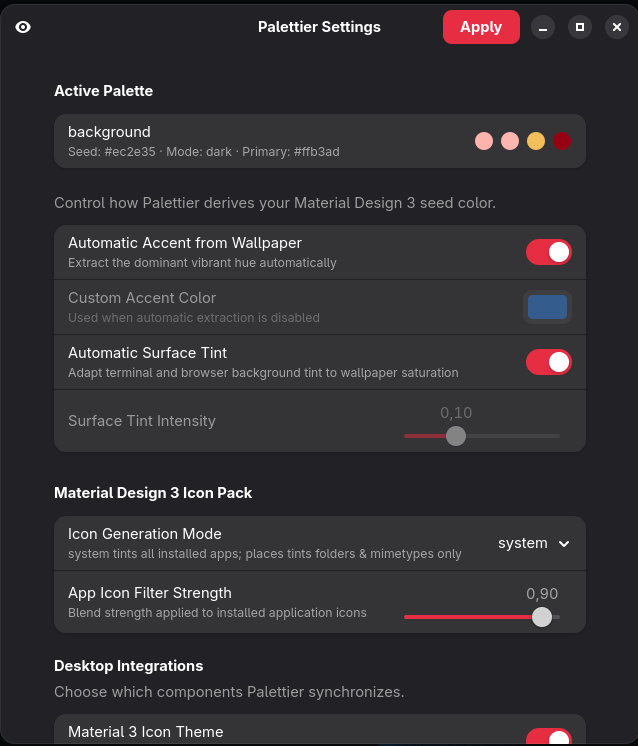
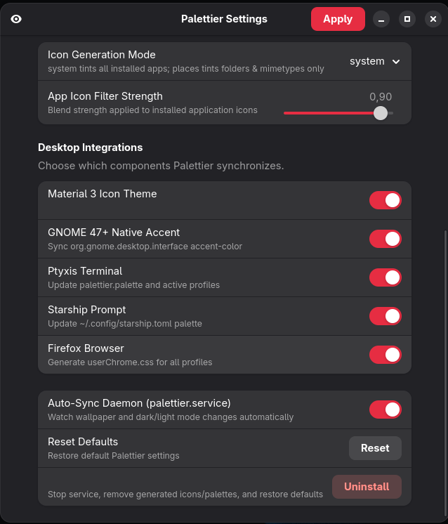

<p align="center">
  
</p>

<h1 align="center">Palettier</h1>

<p align="center"><strong>Your wallpaper, your entire desktop.</strong><br>Dynamic Material Design 3 themes and icon packs for GNOME Linux.</p>

<p align="center">
  <a href="#install"><strong>Install</strong></a> ·
  <a href="#settings-and-configuration">Settings UI</a> ·
  <a href="#cli-and-automation">CLI &amp; Automation</a> ·
  <a href="CONTRIBUTING.md">Contribute</a> ·
  <a href="README.pt-BR.md">Português (PT-BR)</a>
</p>

<p align="center">
  <a href="pyproject.toml"></a>
  <a href="#install"></a>
  <a href="LICENSE"></a>
</p>

Palettier detects your active wallpaper (from GNOME GSettings, slideshow XML descriptors, or a local image file), extracts the dominant accent color via adaptive quantization, and computes **Material Design 3 (CAM16 / HCT)** tonal tokens natively in pure Python. With zero external GNOME extensions required, it keeps your icons, desktop accent, terminal, shell prompt, and browser synchronized in real time.

Documentation is available in **English** and [Português (PT-BR)](README.pt-BR.md).



<details>
<summary><strong>See tinted app icons and architecture</strong></summary>

<p align="center">
  
</p>



</details>

[Features](#your-desktop-in-harmony) · [Install](#install) · [Settings UI](#settings-and-configuration) · [CLI & Automation](#cli-and-automation) · [Guides and Architecture](#guides-and-architecture)

## Your desktop, in harmony

| Feature | What Palettier does |
|---|---|
| **Material Design 3 icons** | Generates M3 `places/` and `mimetypes/` SVGs and applies a shape-preserving tonal LUT across `.svg`, `.svgz`, `.png`, `.webp`, `.jpg`, and `.ico` icons for all installed apps (system, Flatpak, Snap, and AppImage) without changing silhouettes or transparency. |
| **Atomic hot-reload** | Alternates between `Palettier-M3-A` and `Palettier-M3-B` via `gsettings`, forcing GNOME Shell and Nautilus to refresh icons immediately on wallpaper or dark/light scheme switches. |
| **GNOME 47+ accent** | Maps the extracted wallpaper color directly to native `org.gnome.desktop.interface accent-color`. |
| **GTK 3 & 4 + Flatpak apps** | Generates `palettier.css` with M3 accent and tinted surface tokens in `~/.config/gtk-4.0/` (Libadwaita 1.0–1.6+) and `~/.config/gtk-3.0/` (`adw-gtk3` and classic themes) via non-destructive `@import` blocks, and optionally grants Flatpak read-only access (already-open GTK windows apply updates when reopened). |
| **Ptyxis terminal** | Writes `palettier.palette` (including Flatpak paths when detected) and updates your active Ptyxis profile. |
| **Starship prompt** | Updates `[palettes.palettier]` and sets `palette = 'palettier'` inside `~/.config/starship.toml`. |
| **Firefox browser** | Generates `chrome/userChrome.css` and enables stylesheet support in `user.js` across active profiles, supporting horizontal and vertical tabs. |
| **Optional Settings UI** | Includes a native **GTK 4 + Libadwaita** preferences window (`palettier --gui`) and a zero-dependency local **Web Settings UI** fallback (`palettier --web-ui`). |
| **Real-time & reversible** | Reacts to wallpaper changes, theme toggles, and suspend/unlock D-Bus events with 2s debouncing, and cleanly restores every file, AppImage `.desktop`, and original icon theme on `--uninstall`. |

## Install

Run the one-step installer to set up an isolated user virtual environment (`~/.local/share/palettier/venv`), link `palettier` into `~/.local/bin`, register the **Palettier Settings** app launcher, and optionally enable the `systemd --user` background watcher:

```sh
curl -fsSL https://raw.githubusercontent.com/PedroMachado1/Palettier/main/install.sh | bash
```

| Platform / Method | Installation |
|---|---|
| **From local clone** | `git clone https://github.com/PedroMachado1/Palettier.git && cd Palettier && ./install.sh` |
| **Manual `pip`** | `git clone https://github.com/PedroMachado1/Palettier.git && cd Palettier && pip install .` |
| **Fedora** *(GTK 4 + watch)* | `sudo dnf install python3-pillow python3-gobject gtk4 libadwaita` |
| **Ubuntu / Debian** *(GTK 4 + watch)* | `sudo apt install python3-venv python3-pil python3-gi gir1.2-gtk-4.0 gir1.2-adw-1 gir1.2-gio-2.0` |
| **Arch Linux** *(GTK 4 + watch)* | `sudo pacman -S python-pillow python-gobject gtk4 libadwaita` |
| **openSUSE** *(GTK 4 + watch)* | `sudo zypper install python3-Pillow python3-gobject gtk4 libadwaita` |

> Installer options: `--yes` (non-interactive), `--no-service` (skip systemd setup), `--no-gui` (skip `.desktop` launcher), `--uninstall` (remove everything). Without `PyGObject` / `libadwaita`, Palettier still runs via CLI and automatically uses the built-in local Web UI.

## Settings and configuration

Open **Palettier Settings** from your GNOME application grid or run:

```sh
palettier --gui      # Native GTK 4 / Libadwaita window (auto-falls back to Web UI)
palettier --web-ui   # Force the local HTTP Material 3 Web Settings UI
```

| Active Palette & Icon Mode | Target Toggles & Service |
|---|---|
|  |  |

From the interface you can preview active M3 tokens, pick a custom accent override, adjust surface tint and app icon tint strength (`0.0` to `1.0`), switch icon modes (`system`, `places`, `squircle`, `off`), toggle individual targets (**Icons**, **GNOME Accent**, **GTK 3 & 4 Apps**, **GTK Flatpak Integration**, **Ptyxis**, **Starship**, **Firefox**), and start or stop `palettier.service`.

Preferences are persisted in `~/.config/palettier/config.json` and shared across the UI, CLI, `--watch`, and the systemd service:

```json
{
  "icon_mode": "system",
  "icon_tint": 0.9,
  "surface_tint": null,
  "accent_override": null,
  "targets": {
    "icons": true,
    "gnome_accent": true,
    "gtk": true,
    "gtk_flatpak": true,
    "ptyxis": true,
    "starship": true,
    "firefox": true
  }
}
```

Precedence order: **CLI flags** > **Environment variables** (`PALETTIER_ICON_MODE`, `PALETTIER_ICON_TINT`) > **`config.json`** > **Defaults**.

## CLI and automation

```sh
palettier                                        # Sync once from the active wallpaper
palettier --info                                 # Inspect detected wallpaper, config, and M3 palette
palettier --preview-icons                        # Export an HTML preview of M3 icons and colors
palettier --accent "#7aa2f7" --tint 0.12 --force # Override accent color and surface tint
palettier --icon-mode places --icon-tint 0.85    # Customize M3 icon pack mode and filter strength
palettier --watch                                # Watch wallpaper, scheme, and unlock events live
palettier --install-service                      # Install the systemd --user background unit
palettier --uninstall                            # Restore original icons, themes, and desktop files
./uninstall.sh                                   # Remove Palettier binaries, shortcut, venv, and themes
```

## Guides and architecture

| You want to… | Path / Module |
|---|---|
| Inspect pure-Python CAM16 / HCT math & LUTs | [`palettier/palette.py`](palettier/palette.py) |
| Understand wallpaper detection & scoring | [`palettier/wallpaper.py`](palettier/wallpaper.py) |
| Customize M3 icon generation & AppImage bridge | [`palettier/icons.py`](palettier/icons.py) |
| Review Starship, Ptyxis, Firefox & GNOME updaters | [`palettier/targets.py`](palettier/targets.py) |
| Check XDG config schema & runtime state cache | [`palettier/config.py`](palettier/config.py) · [`palettier/state.py`](palettier/state.py) |
| Explore the GTK 4 UI & local Web UI server | [`palettier/gui.py`](palettier/gui.py) · [`palettier/web_ui.py`](palettier/web_ui.py) |
| Review real-time D-Bus / GSettings watcher & service | [`palettier/watch.py`](palettier/watch.py) · [`palettier/service.py`](palettier/service.py) |
| Inspect generated system files | `~/.config/palettier/config.json` · `~/.local/state/palettier/firefox-userChrome.css` · `~/.local/share/icons/Palettier-M3-{A,B}/` |
| Report a bug or propose a feature | Read [CONTRIBUTING.md](CONTRIBUTING.md), then open an [issue](https://github.com/PedroMachado1/Palettier/issues). |

## Contributing

Read [CONTRIBUTING.md](CONTRIBUTING.md) before opening an issue or pull request. To run the automated test suite and validate the installer scripts locally:

```sh
python3 -m unittest discover -s tests -v
bash -n install.sh uninstall.sh
```

Licensed under the [MIT License](LICENSE).

## Star History

<a href="https://www.star-history.com/?repos=PedroMachado1%2FPalettier&type=date&legend=top-left">
 <picture>
   <source media="(prefers-color-scheme: dark)" srcset="https://api.star-history.com/chart?repos=PedroMachado1/Palettier&type=date&theme=dark&legend=top-left" />
   <source media="(prefers-color-scheme: light)" srcset="https://api.star-history.com/chart?repos=PedroMachado1/Palettier&type=date&legend=top-left" />
   
 </picture>
</a>
