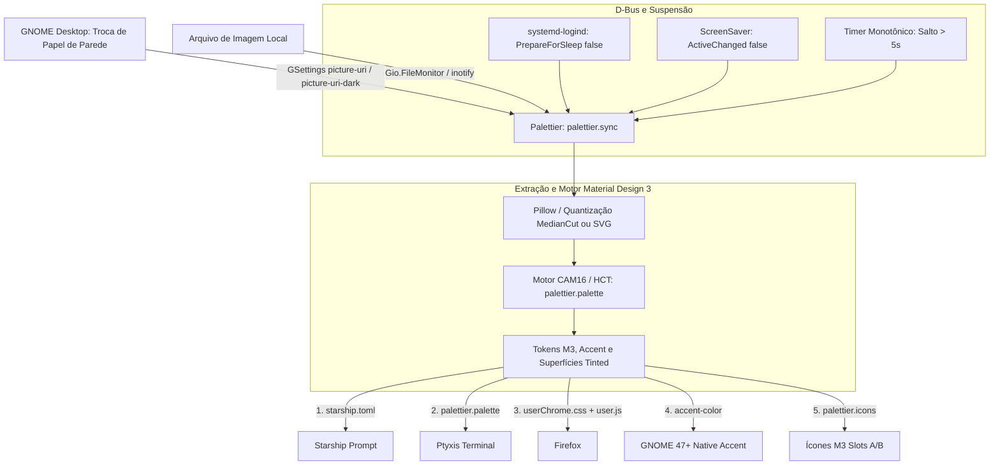

# Palettier

> **Idioma:** [English](README.md) | **Português (PT-BR)**

[](LICENSE)
[](pyproject.toml)

Sincronizador dinâmico de temas e pacote de ícones **Material Design 3** para desktop Linux (GNOME), extraindo a paleta de cores diretamente do papel de parede ativo.

---

## 1. Visão Geral

O **Palettier** detecta o papel de parede ativo (via GSettings/GNOME, XML de slideshow ou arquivo local), extrai a cor de destaque dominante com quantização adaptativa e gera tokens tonais **Material Design 3 (CAM16 / HCT)** para sincronizar automaticamente:

- **Pacote de Ícones Dinâmico Material Design 3** (`Palettier-M3-A` / `Palettier-M3-B`):
  - Pastas (`places/`) e tipos de arquivo (`mimetypes/`) em SVG seguindo os tokens tonais M3.
  - Filtro tonal M3 aplicado aos ícones originais de **todos os aplicativos instalados** (`.desktop` de sistema, usuário, Flatpak, Snap e **AppImage**), preservando 100% da silhueta, transparência e geometria original.
- **Prompt do Terminal (`Starship`)** (`~/.config/starship.toml`).
- **Emulador de Terminal GNOME (`Ptyxis`)** (`palettier.palette` + atualização via GSettings).
- **Navegador Web `Firefox`** (`userChrome.css` e `user.js` em todos os perfis ativos, com suporte a abas horizontais e verticais).
- **Cor de Destaque Nativa do GNOME 47+** (`org.gnome.desktop.interface accent-color`).
- **Interface Opcional de Configurações (`palettier --gui`)**: janela nativa em **GTK 4 + Libadwaita** (com fallback automático para uma **Web UI local** zero-dependências via `--web-ui`).

> [!NOTE]
> **Sem dependências de extensões externas**: toda a extração de cores e o cálculo da paleta Material Design 3 são executados nativamente em Python pelo pacote [`palettier`](palettier/).

---

## 2. Arquitetura e Fluxo de Execução



---

## 3. Instalação Rápida

### Opção A — Instalador em Um Comando (Recomendado)

O instalador detecta automaticamente sua distribuição Linux, cria um ambiente virtual isolado do usuário (`~/.local/share/palettier/venv`), instala o comando `palettier` em `~/.local/bin`, registra o atalho **Palettier Settings** no menu de aplicativos e configura opcionalmente o serviço `systemd --user`:

```bash
curl -fsSL https://raw.githubusercontent.com/PedroMachado1/Palettier/main/install.sh | bash
```

Ou a partir de um clone local:

```bash
git clone https://github.com/PedroMachado1/Palettier.git
cd Palettier
./install.sh
```

> Opções do instalador: `--yes` (não interativo), `--no-service` (pula configuração do systemd), `--no-gui` (pula atalho `.desktop`), `--uninstall` (remove tudo).

### Opção B — Instalação Manual via `pip`

```bash
git clone https://github.com/PedroMachado1/Palettier.git
cd Palettier
pip install .
```

### Pacotes Recomendados do Sistema (para Interface GTK 4 Nativa e `--watch`)

- **Fedora**: `sudo dnf install python3-pillow python3-gobject gtk4 libadwaita`
- **Ubuntu / Debian**: `sudo apt install python3-venv python3-pil python3-gi gir1.2-gtk-4.0 gir1.2-adw-1 gir1.2-gio-2.0`
- **Arch Linux**: `sudo pacman -S python-pillow python-gobject gtk4 libadwaita`
- **openSUSE**: `sudo zypper install python3-Pillow python3-gobject gtk4 libadwaita`

> Mesmo sem `PyGObject` / `libadwaita`, o Palettier funciona normalmente pela linha de comando e abre automaticamente a **Web UI local** (`palettier --gui` / `palettier --web-ui`).

---

## 4. Interface Opcional de Configurações e Configuração Persistente

### Configurações Gráficas (`palettier --gui`)

Abra o **Palettier Settings** pelo menu de aplicativos do GNOME ou pelo terminal:

```bash
palettier --gui      # Janela nativa GTK 4 / Libadwaita (fallback automático para Web UI)
palettier --web-ui   # Abre diretamente a interface Web local Material 3 no navegador
```

Pela interface você pode:
- Visualizar em tempo real os tokens de cor **Material Design 3** extraídos do seu papel de parede.
- Alternar entre **Cor de Destaque Automática** ou escolher uma **Cor Personalizada**.
- Ajustar a intensidade de **Surface Tint** e a força do **Filtro Tonal dos Ícones** (`0.0` a `1.0`).
- Escolher o modo dos ícones (`system`, `places`, `squircle`, `off`).
- Ativar ou desativar alvos individuais (**Ícones**, **GNOME Accent**, **Ptyxis**, **Starship**, **Firefox**).
- Ligar/desligar o serviço em segundo plano (`palettier.service`) e abrir a prévia HTML dos ícones.

### Arquivo de Configuração (`~/.config/palettier/config.json`)

As preferências salvas em `~/.config/palettier/config.json` valem para execuções manuais na CLI, `--watch`, serviço `systemd --user` e interface gráfica:

```json
{
  "icon_mode": "system",
  "icon_tint": 0.9,
  "surface_tint": null,
  "accent_override": null,
  "targets": {
    "icons": true,
    "gnome_accent": true,
    "ptyxis": true,
    "starship": true,
    "firefox": true
  }
}
```

Ordem de precedência: **Flags da CLI** > **Variáveis de ambiente** (`PALETTIER_ICON_MODE`, `PALETTIER_ICON_TINT`) > **`config.json`** > **Padrões**.

---

## 5. Detalhes dos Módulos e Integrações

### 5.1. Núcleo e Extração (`palettier/wallpaper.py` & `palettier/state.py`)

1. **Detecção do Papel de Parede (`get_current_wallpaper_path`)**:
   - Lê `org.gnome.desktop.interface color-scheme` e consulta `picture-uri-dark` ou `picture-uri` em `org.gnome.desktop.background`.
   - Converte URIs `file://`, decodifica caracteres especiais, resolve slideshows `.xml` do GNOME e possui fallbacks (`~/.config/background`, `~/.fehbg` e diretórios padrão de wallpapers).
2. **Extração e Matemática de Cores (`extract_wallpaper_colors`)**:
   - Redimensiona a imagem para processamento rápido e aplica quantização adaptativa de 24 cores (`MedianCut`).
   - Pontua cores candidatas equilibrando população, saturação e luminosidade:
     $$\text{Score} = \text{População}^{0.55} \times \text{Saturação}^{1.4} \times \text{FatorLuminosidade}$$
   - Calcula automaticamente o *tint intensity* (`0.08` a `0.14`) conforme a saturação média do wallpaper e também suporta papéis de parede vetoriais em `.svg`.
3. **Cache de Estado (`$XDG_RUNTIME_DIR/palettier.state`)**:
   - Evita reprocessamento redundante quando wallpaper (SHA-256), esquema de cores, URIs, modo de ícones e `config.json` não mudaram (a menos que `--force` seja usado).
   - Aguarda automaticamente o término de transações RPM/DNF ativas antes de avaliar o estado.

### 5.2. Pacote de Ícones Dinâmico Material Design 3 (`palettier/palette.py` & `palettier/icons.py`)

1. **Motor CAM16 / HCT (`palettier/palette.py`)**:
   - Implementação em Python puro de `SchemeTonalSpot` (Material Design 3), derivando tokens para **Dark** e **Light** (`primary`, `secondary`, `tertiary`, `error`, `surfaceContainer*`, `outlineVariant`) com contraste WCAG verificado.
   - Gera tabelas de consulta perceptuais (`build_icon_tint_luts`) para mapear ícones originais para a paleta do wallpaper mantendo luzes, sombras, brancos e contraste.
2. **Pastas, Mimetypes e Filtro Tonal em Todos os Apps (`palettier/icons.py`)**:
   - Cria os ícones M3 em `~/.local/share/icons/Palettier-M3-{A,B}/scalable/` para `places/` e `mimetypes/`.
   - Varre todos os `.desktop` instalados (sistema, usuário, Flatpak, Snap, **AppImage** e `XDG_DATA_DIRS`) e busca seus ícones em temas instalados, diretórios `pixmaps/` e ícones soltos em `~/.local/share/icons/` ou `~/.icons/`.
   - Aplica o filtro tonal M3 sobre `.svg`, `.svgz`, `.png`, `.webp`, `.jpg` e `.ico` sem alterar formato, contorno, transparência ou geometria original.
   - Constrói a cadeia `Inherits=` no `index.theme` priorizando temas locais existentes (`MoreWaita`, `Papirus-Dark`/`Papirus`, `Adwaita`, `hicolor`).
3. **Ponte Reversível para AppImages (`.desktop` com caminho absoluto)**:
   - Aplicativos AppImage costumam definir `Icon=/caminho/absoluto/...` no `.desktop` do usuário (`~/.local/share/applications/`), o que faz o GNOME ignorar o tema de ícones ativo.
   - O Palettier copia o ícone original para `hicolor`, registra o valor original em `~/.local/share/icons/.palettier_desktop_icons.json` e troca `Icon=` para um nome temável `palettier-app-*`.
   - Ao executar `palettier --uninstall`, todos os `.desktop` modificados são restaurados exatamente para o valor original.
4. **Modos de Ícones (`--icon-mode` / `PALETTIER_ICON_MODE`)**:
   - `system` ou `full` *(padrão)*: pastas e mimetypes M3 + **todos os aplicativos instalados** com filtro tonal M3 sobre os ícones originais (intensidade ajustável via `--icon-tint`, padrão `0.90`).
   - `places`: apenas pastas, locais e mimetypes M3.
   - `squircle`: estilo opcional com squircles Material You padronizados para apps principais.
   - `off`: desativa a geração de ícones.
5. **Hot-Reload Atômico no GNOME**:
   - Alterna entre os dois slots `Palettier-M3-A` ↔ `Palettier-M3-B` via `gsettings`, forçando GNOME Shell e Nautilus a recarregar os ícones na hora. O tema anterior é salvo em `.palettier_prev_icon_theme` para restauração no `--uninstall`.

### 5.3. Starship, Ptyxis, Firefox e GNOME Accent (`palettier/targets.py`)

- **Starship (`~/.config/starship.toml`)**: atualiza `[palettes.palettier]` com `palette = 'palettier'`.
- **Ptyxis (`~/.local/share/org.gnome.Ptyxis/palettes/`)**: gera `palettier.palette` (além de caminhos Flatpak se presentes) e configura todos os perfis via GSettings (`org.gnome.Ptyxis.Profile`).
- **Firefox**: localiza perfis em `~/.config/mozilla/firefox/` e `~/.mozilla/firefox/` via `profiles.ini`, ativa `toolkit.legacyUserProfileCustomizations.stylesheets = true;` em `user.js` e grava `chrome/userChrome.css` com suporte a abas horizontais, barra lateral e abas verticais.
- **GNOME 47+**: mapeia a cor de destaque extraída para a chave nativa `accent-color` em `org.gnome.desktop.interface`.

### 5.4. Automação em Tempo Real (`palettier/watch.py`)

- **GSettings + `Gio.FileMonitor`**: reage imediatamente à troca de papel de parede, alteração de `color-scheme` (claro/escuro) ou sobrescrita do arquivo da imagem com debounce de 2,0s.
- **Retorno de Suspensão e Desbloqueio (3 camadas)**:
  1. D-Bus do sistema (`org.freedesktop.login1.Manager.PrepareForSleep` = `false`);
  2. D-Bus da sessão (`org.gnome.ScreenSaver` / `org.freedesktop.ScreenSaver` `ActiveChanged` = `false`);
  3. Fallback por salto monotônico (`time.monotonic()` > 5s entre ciclos).

---

## 6. Estrutura do Projeto e Destinos no Sistema

| Arquivo / Caminho | Origem / Destino | Função |
|---|---|---|
| `pyproject.toml` | Repositório | Metadados do pacote Python e pontos de entrada `palettier` / `palettier-gui` |
| `install.sh` / `uninstall.sh` | Repositório | Scripts de instalação e desinstalação em um passo |
| `palettier/config.py` | Pacote | Configuração persistente em XDG JSON (`config.json`) |
| `palettier/palette.py` | Pacote | Motor CAM16 / HCT Material Design 3 e LUTs de tint |
| `palettier/wallpaper.py` | Pacote | Helpers GSettings, detecção de wallpaper e extração de cores |
| `palettier/state.py` | Pacote | Cache de estado `.state` e bloqueio durante transações RPM/DNF |
| `palettier/targets.py` | Pacote | Atualizadores de Starship, Ptyxis, Firefox e GNOME accent |
| `palettier/icons.py` | Pacote | Gerador SVG M3, filtro tonal em apps/AppImages e hot-reload |
| `palettier/sync.py` | Pacote | Orquestrador idempotente de sincronização de temas |
| `palettier/watch.py` | Pacote | Monitoramento em tempo real via GSettings, D-Bus e arquivos |
| `palettier/gui.py` | Pacote | Interface nativa GTK 4 + Libadwaita com fallback Web UI |
| `palettier/web_ui.py` | Pacote | Interface Web local Material 3 sem dependências externas |
| `palettier/service.py` | Pacote | Instalação do serviço systemd e desinstalação completa |
| `palettier/cli.py` | Pacote | Interface de linha de comando (`palettier`) |
| `palettier/assets/palettier.svg` | Pacote | Ícone vetorial da aplicação |
| `palettier.service` | Repositório | Modelo de referência da unit systemd do usuário |
| `tests/` | Repositório | Suíte de testes unitários para HCT, ícones, config, UI, alvos e CLI |
| `~/.config/palettier/config.json` | Configuração | Preferências persistentes (modo, tint, override e alvos ativos) |
| `~/.local/state/palettier/firefox-userChrome.css` | Gerado | Cópia de referência do `userChrome.css` gerado |
| `~/.local/share/icons/Palettier-M3-{A,B}/` | Gerado | Slots alternados do tema de ícones Material Design 3 |
| `~/.local/share/icons/.palettier_prev_icon_theme` | Gerado | Backup do tema de ícones original do usuário |
| `~/.local/share/icons/.palettier_desktop_icons.json` | Gerado | Mapa de restauração de `.desktop` (ex.: AppImages) |
| `~/.config/systemd/user/palettier.service` | Gerado | Serviço systemd do usuário para `--watch` |
| `~/.config/starship.toml` | Sistema | Paleta dinâmica aplicada ao prompt Starship |
| `~/.local/share/org.gnome.Ptyxis/palettes/palettier.palette` | Sistema / Flatpak | Paleta dinâmica do terminal Ptyxis |
| `~/.config/mozilla/firefox/<perfil>/chrome/userChrome.css` | Sistema | Estilos dinâmicos aplicados ao Firefox |
| `~/.config/mozilla/firefox/<perfil>/user.js` | Sistema | Habilita carregamento do `userChrome.css` |

---

## 7. Guia de Linha de Comando (CLI) e Variáveis de Ambiente

### Variáveis de Ambiente

| Variável | Valores | Padrão | Descrição |
|---|---|---|---|
| `PALETTIER_ICON_MODE` | `system`, `full`, `places`, `squircle`, `off` | `system` | Define o modo padrão do gerador de ícones M3 |
| `PALETTIER_ICON_TINT` | `0.0` a `1.0` | `0.90` | Define a intensidade padrão do filtro tonal M3 nos ícones de apps |

### Comandos Principais

```bash
# Abrir interface gráfica de configurações (GTK 4 / Libadwaita ou Web UI)
palettier --gui

# Abrir diretamente a interface Web local (adicione --no-browser em modo headless)
palettier --web-ui

# Sincronização única com o wallpaper ativo
palettier

# Forçar reaplicação escolhendo modo e intensidade do filtro dos ícones
palettier --icon-mode system --icon-tint 0.90 --force

# Sobrescrever cor de destaque (#HEX) e intensidade de tint manualmente
palettier --accent "#7aa2f7" --tint 0.12 --force

# Sincronizar sem gerar/alterar ícones
palettier --no-icons

# Gerar pré-visualização HTML da paleta M3 e dos ícones
palettier --preview-icons

# Exibir diagnóstico do wallpaper ativo, configuração, cor extraída e paleta M3
palettier --info

# Sincronizar a partir de uma imagem específica
palettier --image /caminho/para/wallpaper.jpg

# Executar daemon de monitoramento em tempo real
palettier --watch
```

### Gerenciamento do Serviço e Desinstalação

```bash
# Instalar serviço systemd do usuário
palettier --install-service

# Status, logs em tempo real e reinício
systemctl --user status palettier.service
journalctl --user -u palettier.service -f
systemctl --user restart palettier.service

# Remover apenas o serviço systemd
palettier --uninstall-service

# Restaurar padrões (remove serviço, slots M3, paletas, Firefox e restaura .desktop/ícones)
palettier --uninstall

# Remoção completa (binários, atalho .desktop, venv e temas)
./uninstall.sh
```

---

## 8. Testes Automatizados e Contribuição

Para validar a matemática de cores HCT, contraste WCAG, preservação de silhueta/alpha em PNG e SVG, ponte de AppImages, alternância de slots, configuração persistente, API da Web UI, alvos de tema e CLI:

```bash
python3 -m unittest discover -s tests -v
bash -n install.sh uninstall.sh
```

Contribuições são bem-vindas! Consulte [CONTRIBUTING.md](CONTRIBUTING.md) e [LICENSE](LICENSE) (MIT).
