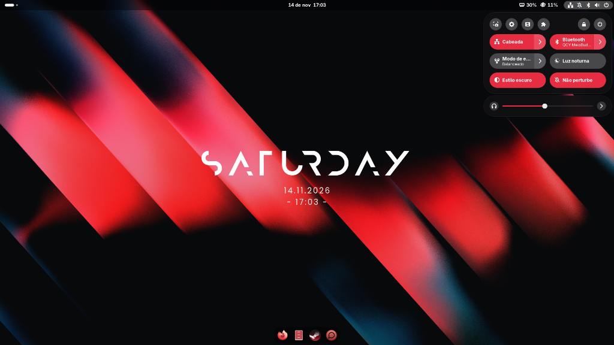
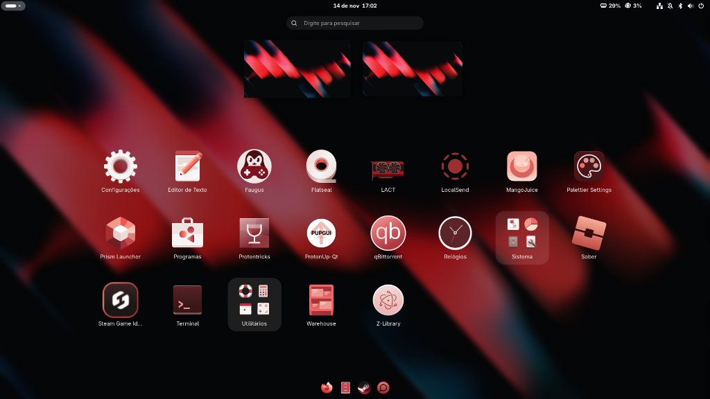
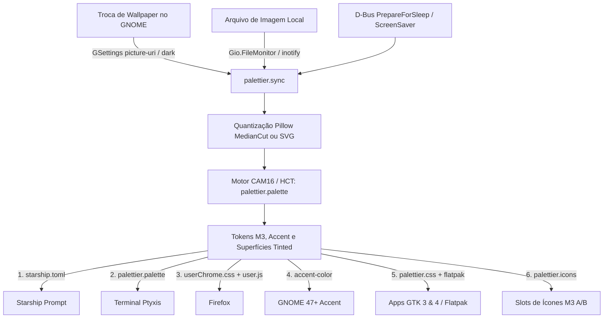
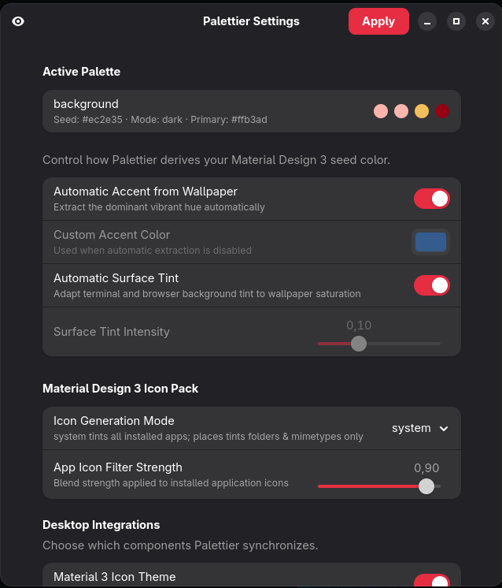
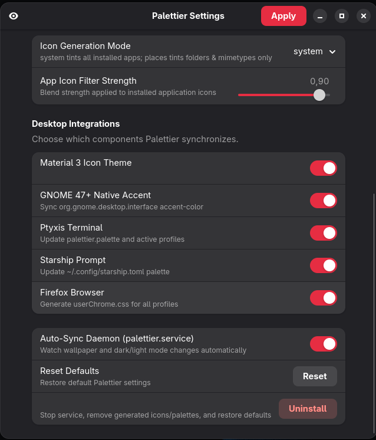

<p align="center">
  
</p>

<h1 align="center">Palettier</h1>

<p align="center"><strong>Seu papel de parede em todo o sistema.</strong><br>Temas dinâmicos e pacote de ícones Material Design 3 para Linux GNOME.</p>

<p align="center">
  <a href="#instalação"><strong>Instalar</strong></a> ·
  <a href="#configurações-e-interface">Interface gráfica</a> ·
  <a href="#cli-e-automação">CLI e automação</a> ·
  <a href="CONTRIBUTING.md">Contribuir</a> ·
  <a href="README.md">English</a>
</p>

<p align="center">
  <a href="pyproject.toml"></a>
  <a href="#instalação"></a>
  <a href="LICENSE"></a>
</p>

O Palettier detecta o papel de parede ativo (via GSettings/GNOME, XML de slideshow ou arquivo local), extrai a cor de destaque dominante com quantização adaptativa e calcula tokens tonais **Material Design 3 (CAM16 / HCT)** nativamente em Python puro. Sem depender de extensões externas do GNOME, ele mantém ícones, cor de destaque, terminal, prompt e navegador sincronizados em tempo real.

Documentação disponível em [English](README.md) e **Português (PT-BR)**.



<details>
<summary><strong>Ver grade de aplicativos com ícones tingidos e arquitetura</strong></summary>

<p align="center">
  
</p>



</details>

[Recursos](#seu-desktop-em-harmonia) · [Instalação](#instalação) · [Configurações](#configurações-e-interface) · [CLI e Automação](#cli-e-automação) · [Guias e Arquitetura](#guias-e-arquitetura)

## Seu desktop, em harmonia

| Recurso | O que o Palettier faz |
|---|---|
| **Ícones Material Design 3** | Gera SVGs M3 para `places/` e `mimetypes/` e aplica um filtro tonal LUT em `.svg`, `.svgz`, `.png`, `.webp`, `.jpg` e `.ico` de todos os aplicativos instalados (sistema, Flatpak, Snap e AppImage) preservando silhueta e transparência. |
| **Hot-reload atômico** | Alterna entre `Palettier-M3-A` e `Palettier-M3-B` via `gsettings`, fazendo o GNOME Shell e o Nautilus atualizarem os ícones na hora ao trocar o wallpaper ou o modo claro/escuro. |
| **Accent do GNOME 47+** | Mapeia a cor extraída do papel de parede diretamente para a chave nativa `org.gnome.desktop.interface accent-color`. |
| **Apps GTK 3 & 4 + Flatpak** | Gera `palettier.css` com cor de destaque e superfícies M3 tingidas em `~/.config/gtk-4.0/` (Libadwaita 1.0–1.6+) e `~/.config/gtk-3.0/` (`adw-gtk3` e temas clássicos) via `@import` não-destrutivo, com permissão opcional somente leitura para Flatpaks (janelas GTK já abertas aplicam as novas cores ao serem reabertas). |
| **Terminal Ptyxis** | Gera `palettier.palette` (incluindo caminhos Flatpak quando presentes) e atualiza automaticamente o perfil ativo do Ptyxis. |
| **Prompt Starship** | Atualiza `[palettes.palettier]` e define `palette = 'palettier'` em `~/.config/starship.toml`. |
| **Navegador Firefox** | Gera `chrome/userChrome.css` e ativa suporte a folhas de estilo em `user.js` em todos os perfis ativos, com suporte a abas horizontais e verticais. |
| **Interface opcional** | Traz janela nativa em **GTK 4 + Libadwaita** (`palettier --gui`) e fallback automático para **Web UI local** sem dependências (`palettier --web-ui`). |
| **Tempo real e reversível** | Reage a trocas de wallpaper, modo claro/escuro e sinais D-Bus de suspensão/desbloqueio com debounce de 2s, restaurando tudo perfeitamente no `--uninstall`. |

## Instalação

Execute o instalador em um comando para criar um ambiente virtual isolado (`~/.local/share/palettier/venv`), instalar o comando `palettier` em `~/.local/bin`, registrar o atalho **Palettier Settings** no menu e configurar opcionalmente o serviço `systemd --user`:

```sh
curl -fsSL https://raw.githubusercontent.com/PedroMachado1/Palettier/main/install.sh | bash
```

| Plataforma / Método | Instalação |
|---|---|
| **Via clone local** | `git clone https://github.com/PedroMachado1/Palettier.git && cd Palettier && ./install.sh` |
| **Via `pip` manual** | `git clone https://github.com/PedroMachado1/Palettier.git && cd Palettier && pip install .` |
| **Fedora** *(GTK 4 + watch)* | `sudo dnf install python3-pillow python3-gobject gtk4 libadwaita` |
| **Ubuntu / Debian** *(GTK 4 + watch)* | `sudo apt install python3-venv python3-pil python3-gi gir1.2-gtk-4.0 gir1.2-adw-1 gir1.2-gio-2.0` |
| **Arch Linux** *(GTK 4 + watch)* | `sudo pacman -S python-pillow python-gobject gtk4 libadwaita` |
| **openSUSE** *(GTK 4 + watch)* | `sudo zypper install python3-Pillow python3-gobject gtk4 libadwaita` |

> Opções do instalador: `--yes` (não interativo), `--no-service` (pula configuração do systemd), `--no-gui` (pula atalho `.desktop`), `--uninstall` (remove tudo). Mesmo sem `PyGObject` / `libadwaita`, o Palettier funciona pela CLI e abre a Web UI local automaticamente.

## Configurações e interface

Abra **Palettier Settings** pelo menu de aplicativos do GNOME ou execute:

```sh
palettier --gui      # Janela nativa GTK 4 / Libadwaita (fallback automático para Web UI)
palettier --web-ui   # Abre diretamente a interface Web local Material 3
```

| Paleta Ativa e Modo de Ícones | Integrações e Serviço |
|---|---|
|  |  |

Pela interface você pode visualizar os tokens M3 ativos, definir uma cor de destaque personalizada, ajustar a intensidade do *surface tint* e do filtro tonal dos ícones (`0.0` a `1.0`), alternar o modo dos ícones (`system`, `places`, `squircle`, `off`), ativar/desativar alvos individuais (**Ícones**, **GNOME Accent**, **Apps GTK 3 & 4**, **Integração GTK Flatpak**, **Ptyxis**, **Starship**, **Firefox**) e controlar o `palettier.service`.

Suas preferências ficam salvas em `~/.config/palettier/config.json` e são compartilhadas entre interface gráfica, CLI, `--watch` e serviço `systemd`:

```json
{
  "icon_mode": "system",
  "icon_tint": 0.9,
  "surface_tint": null,
  "accent_override": null,
  "targets": {
    "icons": true,
    "gnome_accent": true,
    "gtk": true,
    "gtk_flatpak": true,
    "ptyxis": true,
    "starship": true,
    "firefox": true
  }
}
```

Ordem de precedência: **Flags da CLI** > **Variáveis de ambiente** (`PALETTIER_ICON_MODE`, `PALETTIER_ICON_TINT`) > **`config.json`** > **Padrões**.

## CLI e automação

```sh
palettier                                        # Sincronização única com o wallpaper ativo
palettier --info                                 # Exibe diagnóstico do wallpaper, config e paleta M3
palettier --preview-icons                        # Gera pré-visualização HTML das cores e ícones
palettier --accent "#7aa2f7" --tint 0.12 --force # Sobrescreve cor de destaque e surface tint
palettier --icon-mode places --icon-tint 0.85    # Personaliza o modo de ícones e força do filtro
palettier --watch                                # Monitora wallpaper, tema e desbloqueio em tempo real
palettier --install-service                      # Instala a unit de usuário systemd --user
palettier --uninstall                            # Restaura ícones, temas e arquivos .desktop originais
./uninstall.sh                                   # Remove binários, atalho .desktop, venv e temas
```

## Guias e arquitetura

| Você quer… | Caminho / Módulo |
|---|---|
| Ver a matemática CAM16 / HCT e LUTs em Python puro | [`palettier/palette.py`](palettier/palette.py) |
| Entender a detecção e pontuação de cores do wallpaper | [`palettier/wallpaper.py`](palettier/wallpaper.py) |
| Personalizar o gerador de ícones M3 e ponte AppImage | [`palettier/icons.py`](palettier/icons.py) |
| Consultar os alvos Starship, Ptyxis, Firefox e GNOME | [`palettier/targets.py`](palettier/targets.py) |
| Ver esquema do `config.json` e cache de estado | [`palettier/config.py`](palettier/config.py) · [`palettier/state.py`](palettier/state.py) |
| Explorar a interface GTK 4 e o servidor Web UI local | [`palettier/gui.py`](palettier/gui.py) · [`palettier/web_ui.py`](palettier/web_ui.py) |
| Conferir o watcher D-Bus / GSettings e serviço systemd | [`palettier/watch.py`](palettier/watch.py) · [`palettier/service.py`](palettier/service.py) |
| Localizar arquivos gerados no sistema | `~/.config/palettier/config.json` · `~/.local/state/palettier/firefox-userChrome.css` · `~/.local/share/icons/Palettier-M3-{A,B}/` |
| Reportar um bug ou sugerir um recurso | Leia [CONTRIBUTING.md](CONTRIBUTING.md) e abra uma [issue](https://github.com/PedroMachado1/Palettier/issues). |

## Contribuição

Leia [CONTRIBUTING.md](CONTRIBUTING.md) antes de abrir uma issue ou pull request. Para rodar os testes automatizados e validar os scripts localmente:

```sh
python3 -m unittest discover -s tests -v
bash -n install.sh uninstall.sh
```

Distribuído sob a [Licença MIT](LICENSE).

## Histórico de estrelas

<a href="https://www.star-history.com/?repos=PedroMachado1%2FPalettier&amp;type=date">
  <picture>
    <source media="(prefers-color-scheme: dark)" srcset="https://api.star-history.com/chart?repos=PedroMachado1/Palettier&amp;type=date&amp;theme=dark">
    
  </picture>
</a>
